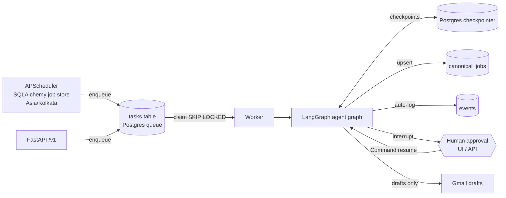
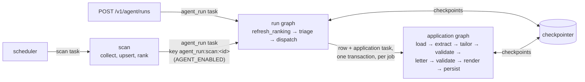
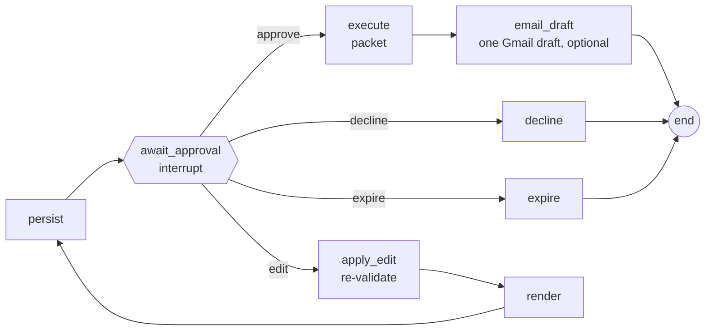

# ADR-001: v2 "Always-On Agent" architecture

- **Status:** Accepted
- **Date:** 2026-11-22
- **Scope:** v2 (branch `v2-always-on`), phases 0–7 in [V2_PLAN.md](../V2_PLAN.md)
- **Supersedes:** the "Auto-apply agent" direction under *Future* in [ROADMAP.md](../ROADMAP.md) (v2 never submits applications; see Guardrails)

## Context

v1.0 works, but only on request. Nothing happens unless a person starts it, and
none of the work in progress survives a restart.

| Concern | How v1 does it | Where | Limitation |
|---|---|---|---|
| Corpus refresh | Manual CLI: `python -m backend.job_scraper.ats_collector` | `job_scraper/ats_collector.py` | Nobody runs it on a schedule. `merge_into_jobs_file()` appends (`existing + new_jobs`) with no dedup, so duplicates pile up on every run and dedup is pushed downstream into `rank_jobs` |
| Corpus storage | `data/jobs.json` (3,875 jobs, gitignored), falling back to the committed `data/sample_jobs.json` (120 jobs) | `config.py`, `api/deps.py:load_jobs` | A JSON list has no stable identity. `canonical_jobs` exists in Postgres but is filled lazily, only when an impression or outcome is logged |
| Ranking runs | `POST /v1/rankings` starts a daemon `threading.Thread`; progress lives in the module-global `_state` dict behind a `threading.Lock` | `api/routers/rankings.py` | State is in memory and per process. A restart loses a running job. The Streamlit re-rank button in `ui/views/jobs.py` is a second, uncoordinated writer of `ranked_jobs.json` (audit **M7**). `_state` can leak between tests (audit **L5**) |
| Outcome logging | Manual: the interactive `input()` CLI `database/log_outcome_cli.py`, or the Tracker tab form, both calling `events.log_outcome()` | `database/events.py` | Outcomes are only recorded if the user remembers to log them. Learning-to-rank needs about 50 real outcomes, and manual logging is the bottleneck (ROADMAP "In Progress") |
| Document generation | Tailored resume and cover letter generated on demand, each checked by the deterministic truthfulness validator | `resume_engine/` | Synchronous and per click. No review queue, no follow-through |

The building blocks v2 needs are already in place: Postgres 16 is in the stack,
`canonical_jobs` and `events` have stable keys and score snapshots, the LLM is
behind a provider abstraction (`backend/llm/`), and the validator is
deterministic. What v1 lacks is a **durable control loop** that runs on its own,
survives restarts, and stops for a human before anything leaves the system.

## Decision

v2 runs as an always-on agent built from five durable components. All of them
keep their state in the Postgres database that already backs `events`.

### 1. LangGraph agent graph with a Postgres checkpointer

The pipeline is a LangGraph `StateGraph`. Nodes are thin wrappers around the
existing domain functions, so the v1 engines are reused rather than rewritten:

`scan → upsert corpus → rank (new/changed only) → shortlist → generate docs → validate → approval gate → execute → record`

- Graph state is checkpointed after every node by `PostgresSaver`
  (`langgraph-checkpoint-postgres`). A crash or deploy resumes from the last
  completed node instead of starting over.
- One graph thread per (candidate, job) application candidate, so each
  shortlisted job can be paused, resumed or audited on its own.
- LLM calls go through the existing `backend/llm/provider.py`
  (Groq/Ollama). v2 adds no new model provider.

### 2. Postgres-backed task queue

A `tasks` table replaces the in-process thread and `_state` in
`api/routers/rankings.py`:

- Workers claim work with `SELECT … FOR UPDATE SKIP LOCKED`, take a lease with
  a heartbeat, and use bounded retries with backoff. Each task carries an
  idempotency key so a retried or duplicate enqueue never runs twice.
- Enqueue happens in the same transaction as the domain write that caused it.
- The `/v1/rankings` contract stays as it is (`POST` returns `202`, clients poll
  status), as the rankings module docstring promised.
- This fixes audit M7 (a single writer for ranking output) and L5 (no
  module-global state).

### 3. APScheduler with a SQLAlchemy job store, timezone `Asia/Kolkata`

- APScheduler 3.x with `SQLAlchemyJobStore` on the same database, so schedules
  survive restarts. The timezone is `Asia/Kolkata`; stored timestamps stay
  `TIMESTAMPTZ` (UTC).
- The scheduler **only enqueues tasks**. It never runs scans or ranking in its
  own process. Jobs use `coalesce=True`, `max_instances=1` and a
  misfire grace window, so a missed run fires once rather than as a burst.
- Exactly one scheduler process runs at a time. APScheduler 3.x does not
  support several schedulers sharing one job store.

### 4. The corpus lives in `canonical_jobs`

- `canonical_jobs` becomes the source of truth. Collectors **upsert** on
  `(company, normalized_title)`, which sets `first_seen_at` on insert and bumps
  `last_seen_at` on every re-sighting. That makes "new since last scan" a
  simple query and makes incremental scans possible.
- `jobs.json` and `sample_jobs.json` stay as a read-only export and fallback,
  so the database-less Streamlit Cloud demo keeps working.

### 5. Approval gate via `interrupt()`, and approvals log their own events

- The approval node calls LangGraph's `interrupt()` with the full review
  packet: job, score breakdown, tailored resume, cover letter, draft email and
  the validator report. The graph pauses durably in the checkpointer.
- The user approves, edits or declines from the UI/API. That resumes the graph
  with `Command(resume=…)`. Edited text goes back through the validator
  before execution.
- Every approval decision is written to `events` automatically, with the score
  snapshot (as `log_outcome()` does today). This replaces manual
  `log_outcome_cli` entry for anything the agent surfaced. The new event types
  (proposed: `approved`, `declined`, `drafted`) mean extending the `events`
  CHECK constraint in both `schema.sql` and `db.py`, plus an idempotent
  migration in `_run_migrations()`. That work belongs to Phase 1.

### Alternatives considered

| Alternative | Why it was rejected |
|---|---|
| Celery or RQ with Redis (suggested in DEPLOYMENT.md) | Adds a broker and another stateful service for one user's workload. A Postgres queue gives enqueue in the same transaction as the domain write, with no new infrastructure |
| Temporal | Real durability, but heavy to run and learn for this scope |
| Cron plus the existing CLIs | No run state, no resume, no human-in-the-loop pause |
| Hand-rolled state machine | Checkpointing and the human-approval pause would have to be rebuilt by hand; LangGraph already provides both |
| Keeping the corpus in JSON | No stable identity, no incremental scans, and append-only duplicates |

## Guardrails (non-negotiable)

These are enforced **structurally**, in what code exists and which edges the
graph has. Prompts are not relied on. Each one gets an automated test by
Phase 7.

1. **Never auto-submit applications.** No node, tool or worker task can submit
   an application. "Execute" means preparing the packet and the apply link.
   The human submits. An `applied` event is recorded only when the user
   confirms they submitted.
2. **Gmail: drafts only.** The Gmail client wrapper exposes `drafts.create`
   (and draft update/delete) and nothing else. Note that Google's
   `gmail.compose` scope *also allows sending*, so the scope alone does not
   prevent it. The wrapper does, and a test checks that no send method is
   reachable.
3. **ATS APIs only.** Jobs come only from the documented public job-board APIs
   (Greenhouse, Ashby, and Lever per verified slug), the same as v1. No
   scraping LinkedIn, Naukri or Indeed, and no headless-browser form filling.
4. **No CAPTCHA bypass.** If a source returns a CAPTCHA, a block or a rate
   limit, the agent backs off and reports it. It never solves, evades or
   outsources a CAPTCHA, and never rotates identity to get around a block.
5. **The truthfulness validator is mandatory on every generated document**:
   tailored resumes, cover letters, email drafts and follow-ups. In the graph,
   every path from `generate` to `approval` goes through `validate`, with the
   v1 fallback to the original bullets. Human edits are validated again.
   Flagged content is shown in the review packet, never silently dropped.

## Consequences

### Positive

- Runs and pending approvals survive restarts and deploys.
- One coordinated writer for ranking output, which closes audit M7 and L5.
- Incremental scans: only new or changed jobs need embedding and ranking.
- Outcome data builds up automatically from approval decisions. That unblocks
  learning-to-rank (about 50 outcomes needed) without relying on manual logging.
- A complete audit trail: every decision is an `events` row with the score
  snapshot and `FORMULA_VERSION` that were active when it was made.

### Negative / trade-offs

- **Postgres becomes required for the agent.** v1's core flows run on JSON
  files alone. The JSON fallback is kept for the hosted demo, but the
  always-on features need a database.
- **Two Postgres drivers.** `langgraph-checkpoint-postgres` uses psycopg 3,
  while the app uses `psycopg2-binary`. Both will be installed until the app
  moves to psycopg 3.
- **New dependencies that change quickly** (`langgraph`, its checkpointer,
  APScheduler, Google API client). Pin their versions. Checkpoint tables are
  owned by LangGraph (`setup()`) and are not part of `schema.sql`.
- **The queue polls.** That adds latency (seconds) and has a throughput
  ceiling compared with a dedicated broker. That is fine for one user. If
  multi-user load arrives, revisit with LISTEN/NOTIFY or a broker.
- **Only one scheduler process.** It needs an explicit deployment constraint
  (or an advisory lock) to prevent duplicate schedules.
- **Identity key weakness.** `(company, normalized_title)` merges the same title
  posted in several locations or with several requisition IDs. Phase 1 should
  look at adding the source's posting ID as a secondary key.
- **Gmail OAuth.** Refresh tokens are a new secret to store and rotate. A
  personal OAuth client in testing mode works for one user. A public
  multi-user release would need Google's OAuth verification for Gmail scopes.
- **Validator coverage has to grow.** Email drafts and follow-ups are new
  document types, and the validator has to handle them (per paragraph, as
  `cover_letter.validate_letter` does) before they can be generated.
- **More moving parts to run** (API, worker, scheduler, database) than v1's
  API, UI and database. Health checks and run logs are Phase 7 work.

## Addendum (Phase 4): the queue and LangGraph split

- **Date:** 2026-11-23
- **Status:** Accepted (Phase 4, dry run)

§1 drew one graph, `scan → upsert → rank → shortlist → generate → validate
→ approval → execute → record`. Phase 4 builds it as **queue tasks that
each run a checkpointed LangGraph graph**, cut at the points where work
fans out or is already a task:

**The queue owns *between-task* durability, LangGraph owns *within-task*
durability.**

- The **task queue** (§2) decides what runs, where and when. It provides
  leases, fencing, retries with backoff, `max_attempts`, dead tasks,
  concurrency keys (one agent run at a time) and idempotency keys (a
  retried scan chains the same agent run; each application has exactly one
  task). These are all things LangGraph doesn't provide across processes.
- **LangGraph** decides how far a task got. Each task invokes its graph on
  a thread named after the work (`agent_run:<task_id>`,
  `application:<application_id>`) with `durability="sync"`, so every
  step's checkpoint is committed before the next step starts. A retried
  task invokes the same thread again and resumes at the node its last
  attempt died in: finished nodes, and their LLM calls, never re-run. A
  thread that already finished returns its saved final state. LangGraph
  runs with no retry policy of its own, so all retrying stays in one
  place.
- **Fan-out goes through the queue, not `Send`.** `dispatch` writes each
  `applications` row and its `application` task in the same transaction
  (§2: "enqueue in the same transaction as the domain write"). Each
  application is then a separate task and a separate thread, which is §1's
  "one graph thread per (candidate, job)". Applications get leased,
  retried and failed on their own, and any worker can take them. In-graph
  fan-out would tie them all to one task's lease and one worker.
- **The scan stays a plain task.** It existed before the agent and also
  runs without it (`AGENT_ENABLED=false`, the default). It chains the
  agent as its last step instead of becoming a node.
- **Failure ends in the domain.** When a task is dead (last attempt
  raised, or its lease expired on the last attempt), a per-kind dead
  handler on the worker marks the application `failed` with the error.
- **Granularity:** one LLM call per LLM node. A crash re-runs at most one
  call. The agent's resume tailoring is therefore one call for all
  projects (`tailor_resume_single_call`); the CLI keeps its per-project
  calls.
- **Phase 5** adds the approval gate as an `interrupt()` in the
  application graph after `persist`, resumed with `Command(resume=…)` on
  the same thread. Nothing in Phase 4 sends, uploads or submits anything.

Consequences: there are two kinds of durable state to operate, task rows
and checkpoint threads, and nothing prunes old threads yet (Phase 7). Their
names make each one traceable from the other.

## Addendum (Phase 5): the approval gate

- **Date:** 2026-11-23
- **Status:** Accepted (Phase 5)

**Interrupt, then complete.** §5's gate is `interrupt({application_id,
version})` in the application graph, right after `persist`. The
`application` task does not wait for the person: the interrupt is
checkpointed (`durability="sync"`) and the task **completes** with
`state: awaiting_approval`. A decision is data first (an `approvals` row,
one per (application, version), written in the same transaction as the
`application_decision` task that applies it) and a graph resume second:
that task resumes the same thread with `Command(resume=decision)`. The
queue's ownership split from the Phase 4 addendum holds: the queue decides
when the resume runs and retries it, and the checkpoint decides where it
continues. A crash after the resume continues at the node it died in. A
retried task whose decision was already applied (the thread waits on a
newer version, or finished) changes nothing. The nodes after the gate make
no LLM call for approve, decline or expire.

- **Versions and conflicts.** `applications.version` is the documents'
  version: 1 for the first draft, +1 per edit. A decision names the version
  the person saw; anything but `awaiting_approval` at that version is a 409,
  and so is a second decision on it (the UNIQUE key). Each version gets its
  own `approval_expiry` task (`expiry:<id>:<version>`), which records
  `expire` only if that version is still undecided.
- **Edits are validated, not regenerated.** Edited paragraphs and bullets
  go through the same truthfulness validators (guardrail 5), first in the
  API (a flagged edit is 422 unless acknowledged) and again in the graph on
  the same checkpointed state. An acknowledged human edit is kept as
  written, unlike model output, which falls back to the original bullets.
  Its flags stay in the report and set `needs_review`. The files are
  re-rendered in place; what a decision approved is the current version.
- **One driver per thread.** A per-application advisory lock is held for
  every graph run, so a drafting task still finishing its last step and a
  decision task never drive the same thread at once.

**Packet vs Gmail.** Execution has two steps with different reach.
The **packet** is always built: `packet.json` (the approved documents with
their sha256, the apply link, a job summary, why it matched, the gaps and
the validator's verdict) is recorded as an artifact and a `packet` action,
and the application is `ready_to_apply`. It is everything the human needs
to apply, and the human applies (guardrail 1). The **Gmail draft** is
optional: only when the JD names a contact address (no-reply, privacy,
accommodation, support and similar addresses are skipped) and
`GMAIL_CREDENTIALS_FILE` is set. It is one draft (`email_drafted`): the
approved letter paragraphs in a fixed template, with both `.docx` files
attached. The body adds no generated text, so validating the letter covers
the email too.

**Exactly-once draft.** Gmail has no idempotency key, so the draft gets a
deterministic `Message-ID: <aja-<application_id>-<version>@ai-job-agent>`
(and an `X-AJA-Draft-Key` header). The `application_actions` row
(`gmail_draft`, `pending`, that Message-ID) is **committed before Gmail is
called**. A retry that finds a pending row searches Gmail for the
Message-ID first (`rfc822msgid:`, then the newest drafts' headers, because
search can lag right after a create) and records the draft it finds
instead of creating another. Only then is the row `done`, with the draft
id. `tests/test_agent_gmail_kill.py` SIGKILLs a worker after Gmail returns
and before the row is marked done: the retry finds the draft, and the
mailbox holds exactly one.

**Drafts only, structurally.** `backend/integrations/gmail.py` exposes
`create_draft()` and `find_draft_by_message_id()`. Its single HTTP entry
point refuses any URL outside `users/me/drafts` or containing `/send`,
and tests assert that no send attribute exists and that the mocked HTTP
layer never sees a send URL. OAuth is the installed-app flow for one scope,
`gmail.compose`, over plain HTTPS. The token is stored in
`data/secrets/gmail_token.json` (gitignored) and refreshes itself.

Consequences: a decision task that dies before its decision was consumed
(the gate still waits on that version) has its `approvals` row removed so
the person can decide again. One that dies after leaves the error on the
application, and a manual retry path is Phase 7 work. Old versions' files
are overwritten by an edit; the `approvals.edits` history records what
changed.

